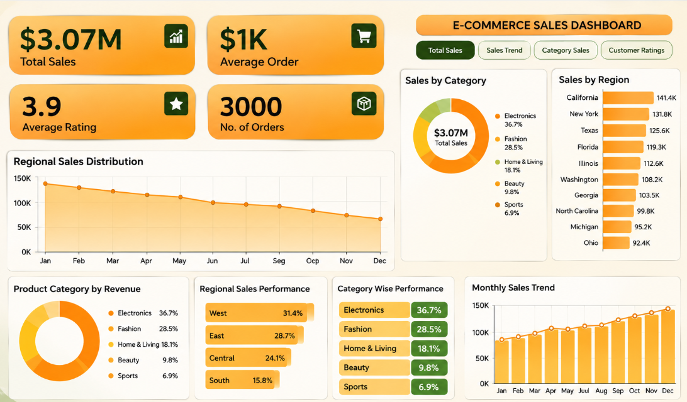
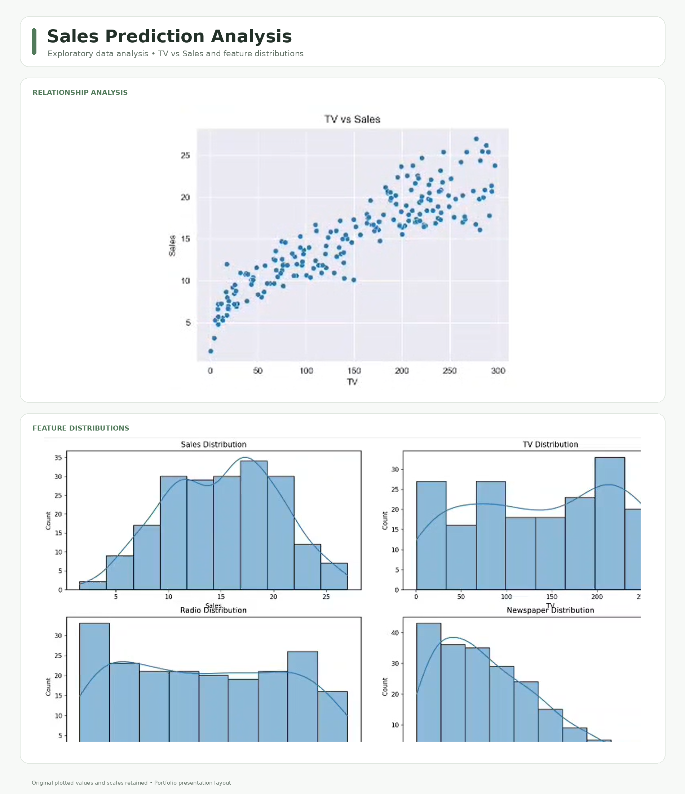

<h1 align="center">👋 Hi, I'm Bhoopathi Samyuktha</h1>

<h3 align="center">📊 Aspiring Data Analyst | Data Science Student</h3>

  Turning data into insights and insights into meaningful decisions.

  <a href="https://www.linkedin.com/in/bhoopathi-samyuktha-4a71b334b">LinkedIn</a> •
  <a href="https://github.com/bhoopathisamyuktha-09">GitHub</a> •
  <a href="mailto:bhoopathisamyuktha@gmail.com">Email</a>

---

## 🌟 About Me

🎓 I'm pursuing a **B.Tech in Computer Science and Engineering (Data Science)** at Vardhaman College of Engineering.

📊 I enjoy exploring data, discovering patterns, creating dashboards, and building data-driven solutions.

💡 My interests include:
- Data Analytics & Business Intelligence
- Data Visualization
- Machine Learning
- Predictive Analytics

🚀 I'm continuously improving my analytical skills and building projects that transform raw data into meaningful insights.

---

## 🎓 Education

**B.Tech – Computer Science and Engineering (Data Science)**  
🏫 Vardhaman College of Engineering  
📅 2024 – 2028

---

## 🛠️ Tech Stack

| Category | Skills |
|---|---|
| 💻 Programming | Python |
| 🗄️ Database | SQL |
| 📊 Data Analytics | Data Cleaning, Data Preparation, EDA |
| 📈 Visualization | Power BI, Excel |
| 🤖 Machine Learning | Recommendation Systems, Predictive Modeling |
| 🧰 Libraries | Pandas, NumPy, Matplotlib, Scikit-learn |
| 🔧 Tools | GitHub, Jupyter Notebook |

---

## 💼 Internship Experience

### 🔐 Infosys Springboard – Threat Detection Project

**SentinelAI: AI-Assisted Security Operations Dashboard (Group Project)**  
*July 2026 – September 2026*

- Contributed to data cleaning and preparation for ML-based threat detection and risk scoring.
- Supported data workflows for security analysis and threat prioritization.

**Tech:** Python, FastAPI, React, MongoDB, Machine Learning

### 📊 CODSOFT – Data Science Intern

*December 2025 – January 2026*

- Completed data science projects involving data cleaning, preprocessing, and exploratory data analysis (EDA).
- Applied machine learning techniques to build and evaluate predictive models using Python.
  
**Tech:** Python, Pandas, NumPy, Matplotlib, Scikit-learn, Jupyter Notebook

---

## 🚀 Featured Projects

### 📊 1. E-commerce Sales Monitoring Dashboard

An interactive Power BI dashboard to explore sales performance and business trends.

✨ **Dashboard Highlights**
- 💰 Total Sales: $3.07M
- 🛒 Average Sale: $1K
- ⭐ Average Rating: 3.9
- 📦 Items: Approximately 3,000

🔗 [Explore Project](https://github.com/bhoopathisamyuktha-09/e-commerce-sales-monitoring)

**Tools:** Power BI, Excel

---

### 🎬 2. Movie Recommendation System

- Developed a movie recommendation system using movie datasets and similarity-based techniques.
- Used Python and machine learning to recommend relevant movies based on user preferences.
  
🔗 [View Project](https://github.com/bhoopathisamyuktha-09/CodSoft/blob/main/task2.py)

**Tools:** Python, Machine Learning

---

### 📈 3. Sales Prediction

- Analyzed advertising data to identify sales patterns and understand the relationship between advertising and sales.
- Built a regression-based machine learning model to predict sales using advertising data.

🔗 [View Project](https://github.com/bhoopathisamyuktha-09/CodSoft/blob/main/task4.py)

**Tools:** Python, Pandas, Scikit-learn

---

## 🏆 CERTIFICATIONS

- **IBM – Data Fundamentals**  
  [View Certificate](https://lnkd.in/p/dPd68ZxH)

- **Infosys Springboard – Data Science**  
  [View Certificate](https://lnkd.in/p/dH_D9pjM)

- **Zomato Review Analysis – Unstop**  
  [View Certificate](https://lnkd.in/p/d7Kn9RvJ)

---

## 💬 Soft Skills

- 🤝 Teamwork and Collaboration
- 🧠 Problem-Solving
- 💬 Communication — B2 (Cambridge Upskill)
- 🌱 Adaptability and Continuous Learning

---

## 🤝 Let's Connect!

I'm always happy to connect with fellow data enthusiasts, learn from new experiences, and explore opportunities in data analytics.

📧 [Email Me](mailto:bhoopathisamyuktha@gmail.com)  
💼 [Connect on LinkedIn](https://www.linkedin.com/in/bhoopathi-samyuktha-4a71b334b)  
🐙 [Explore My GitHub](https://github.com/bhoopathisamyuktha-09)

  ✨ Thanks for visiting my portfolio! ✨

