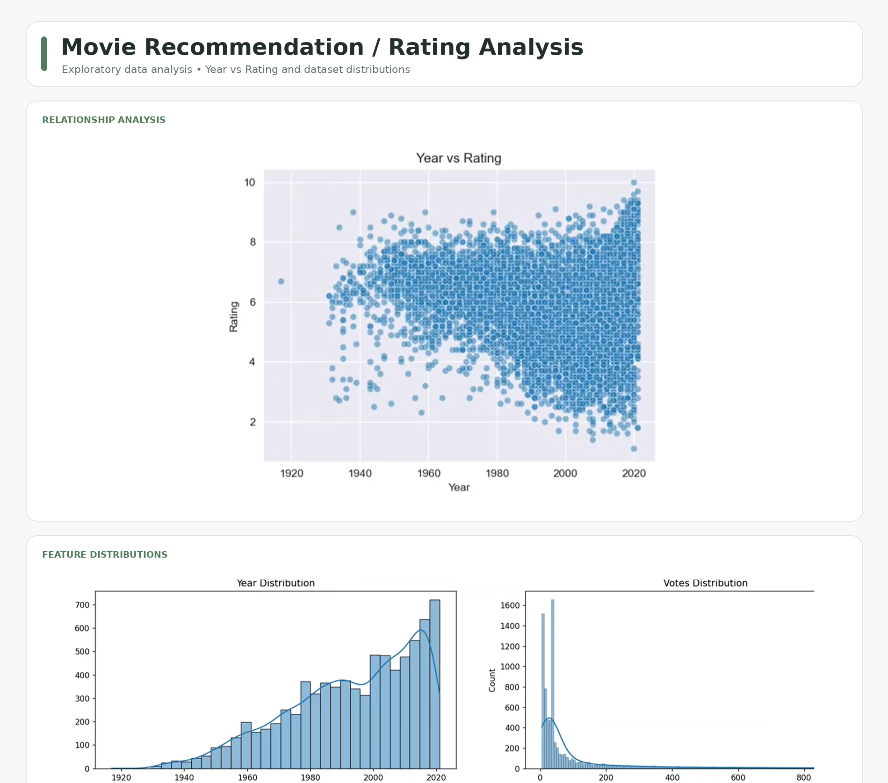

<table width="500%">
  <tr>
    <td width="22%" align="left" valign="middle">
      
    </td>
    <td width="78%" align="left" valign="middle">
      <h1>Bhoopathi Samyuktha</h1>
      <h3>Aspiring Data Analyst</h3>
      <a href="https://github.com/bhoopathisamyuktha-09">GitHub</a> |
      <a href="https://www.linkedin.com/in/bhoopathi-samyuktha-4a71b334b">LinkedIn</a> |
      <a href="mailto:bhoopathisamyuktha@gmail.com">Email</a>
    </td>
  </tr>
</table>

---

## **CAREER OBJECTIVE**

Aspiring Data Analyst with a background in Computer Science and Data Science. Skilled in Python, SQL, Excel, and Power BI, with an interest in data analysis, visualization, and machine learning. Passionate about transforming raw data into meaningful insights and developing data-driven solutions.

## **EDUCATION**

**B.Tech – Computer Science and Engineering (Data Science)**  
Vardhaman College of Engineering  
2024 – 2028

## **TECHNICAL SKILLS**

- **Programming:** Python
- **Database:** SQL
- **Data Analysis:** Data Cleaning, Data Preparation, Exploratory Data Analysis
- **Visualization:** Power BI, Microsoft Excel
- **Machine Learning:** Recommendation Systems, Predictive Modeling

## **INTERNSHIP EXPERIENCE**

**Infosys Springboard – Threat Detection Project**  
*July 2026 – September 2026*

**SentinelAI: AI-Assisted Security Operations Dashboard (Group Project)**

- Collaborated on developing an AI-powered Security Operations Center (SOC) platform for detecting, analyzing, prioritizing, and managing cybersecurity threats.
- **Key Contribution:** Handled data cleaning and data preparation to ensure data quality and readiness for machine learning-based threat detection.
- Contributed to the data preparation workflow supporting threat detection, risk scoring, and security analysis.
- The platform integrates incident management, attack-chain correlation, threat intelligence, vulnerability management, and automated response recommendations.

**Technologies:** Python, FastAPI, React, MongoDB, Machine Learning

**CODSOFT – Data Science Intern**  
*December 2025 – January 2026*

- Completed practical data science tasks and project-based exercises.
- Applied programming and analytical concepts to assigned internship activities.

## **PROJECTS**

### **1. E-commerce Sales Monitoring Dashboard**

**Tools:** Power BI, Excel

- Developed a dashboard to monitor e-commerce sales performance.
- Presented key business metrics, including total sales, average sale value, customer ratings, and item-level information.
- **Dashboard Metrics:** $3.07M sales, $1K average sale, 3.9 average rating, and approximately 3,000 items.
- **Project Links:** [GitHub Repository](https://github.com/bhoopathisamyuktha-09/e-commerce-sales-monitoring) 

### **2. Movie Recommendation System**

**Tools:** Python, Machine Learning

- Developed a machine learning-based movie recommendation system.
- Focused on recommending movies based on user preferences and similarity.
- **Project Links:** [GitHub Repository](https://github.com/bhoopathisamyuktha-09/CodSoft/blob/main/task2.py) 

### **3. Sales Prediction**

**Tools:** Python, Machine Learning

- Developed a machine learning model to predict sales using historical data.
- Focused on identifying sales patterns and forecasting future sales.
-**Project Links:** [GitHub Repository](https://github.com/bhoopathisamyuktha-09/CodSoft/blob/main/task4.py) 

## **CERTIFICATIONS**

- **IBM – Data Fundamentals**  [View Certificate](https://lnkd.in/p/dPd68ZxH)
- **Infosys Springboard – Data Science** [View Certificate](https://lnkd.in/p/dH_D9pjM)
- **Zomato Review Analysis – Unstop:** [View Certificate / Project](https://lnkd.in/p/d7Kn9RvJ)
    
## **AREAS OF INTEREST**

- Data Analytics
- Business Intelligence
- Data Visualization
- Machine Learning
- Predictive Analytics
- Artificial Intelligence

## **CONTACT**

- **GitHub:** [bhoopathisamyuktha-09](https://github.com/bhoopathisamyuktha-09)
- **LinkedIn:** [Bhoopathi Samyuktha](https://www.linkedin.com/in/bhoopathi-samyuktha-4a71b334b)
- **Email:** [bhoopathisamyuktha@gmail.com](mailto:bhoopathisamyuktha@gmail.com)

---

**Connect with me:** [GitHub](https://github.com/bhoopathisamyuktha-09) | [LinkedIn](https://www.linkedin.com/in/bhoopathi-samyuktha-4a71b334b) | [Email](mailto:bhoopathisamyuktha@gmail.com)
